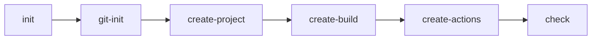

# Архітектура AI-агента build-engineer

## Проблема, яку вирішує агент

Початкове налаштування невеликого JavaScript/Node.js-проєкту часто виконується вручну: потрібно створити структуру файлів, описати npm scripts, додати тестування, кросплатформні CI-скрипти та GitHub Actions. Це створює ризик пропустити перевірку, зробити скрипт несумісним з іншою операційною системою або випадково додати службові файли до Git.

Агент `build-engineer` для GitHub Copilot у VS Code оркеструє ці кроки в установленому порядку. Він готує проєкт Hello World на JavaScript, тест `BasicAddition` на Jest, скрипти `ci.sh`/`ci.bat` і workflow GitHub Actions для Linux, Windows та macOS, а потім перевіряє результат.

## Skills

| Skill | Входи | Виходи |
|---|---|---|
| `project-scaffold` | Мова JavaScript і назва проєкту `hello` | Ідемпотентні каталоги `src/`, `tests/`, `docs/`, `src/hello.js` з Hello World і правила `.gitignore`; README.md лише перевіряється, тест і `package.json` не створюються |
| `build-and-test` | Наявний `src/hello.js` | `src/add.js`, `tests/basic-addition.test.js` з `BasicAddition`, `package.json`, локальні devDependencies, `package-lock.json`, `.gitattributes`, `ci.sh`, `ci.bat` і збірка `build/hello` або `build/hello.exe` |
| `github-actions` | Наявні `ci.sh` і `ci.bat`, які завершуються `CI OK` | `.github/workflows/ci.yml` з однією job і matrix для `ubuntu-latest`, `windows-latest`, `macos-latest`, яка запускає лише локальний скрипт і зберігає executable як artifact |

## Commands

| Command | Передумови | Результат |
|---|---|---|
| `git-init` | `.github/skills/git-init/SKILL.md`; Git-репозиторій | Перевірено репозиторій і гілку, ідемпотентно оновлено `.gitignore`, показано `git status` |
| `create-project` | `.github/skills/create-project/SKILL.md`; успішний `git-init`, Node.js >= 20 | Виконано `project-scaffold` для JavaScript-проєкту `hello` |
| `create-build` | `.github/skills/create-build/SKILL.md`; `src/hello.js` | Виконано `build-and-test`, локальну збірку та перевірено `CI OK` |
| `create-actions` | `.github/skills/create-actions/SKILL.md`; локальний `CI OK` | Виконано `github-actions` і YAML-перевірку workflow |
| `check` | `.github/skills/check/SKILL.md`; готовий проєкт | `scripts/check.js` без змін у проєкті звітує про всі структурні, тестові, build, workflow та security-перевірки |
| `init` | `.github/skills/init/SKILL.md`; агент `build-engineer`, гілка `feature/...` | Оркеструє п'ять commands у порядку `git-init` → `create-project` → `create-build` → `create-actions` → `check` |

## Дані між етапами

Оркестратор передає між commands і skills такі дані:

- **назва проєкту:** `hello`;
- **мова:** JavaScript (Node.js);
- **шляхи файлів:** шляхи до `src/hello.js`, `README.md`, `package.json`, тесту, `ci.sh`, `ci.bat`, `.github/workflows/ci.yml` і `build/hello`;
- **код повернення та результати перевірок:** числовий код завершення команд, який визначає PASS або FAIL;
- **платформи CI:** Linux (`ubuntu-latest`), Windows (`windows-latest`) і macOS (`macos-latest`).

## Обробка помилок оркестратором

Оркестратор `init` зупиняє послідовність на першій помилці. Натомість команда `check` не змінює проєкт і проходить усі перевірки, показуючи для кожної явний звіт `PASS` або `FAIL` із назвою та причиною. Пропущена перевірка не вважається успішною. Приховані виправлення та автоматичне ігнорування помилок не допускаються.

## Відповідність файлів і ролей

| Файл або каталог | Роль |
|---|---|
| `.github/agents/build-engineer.agent.md` | Manifest custom agent із роллю, правилами та доступними інструментами |
| `.github/skills/*/SKILL.md` | Інструкції reusable skills і command-skills |
| `.github/workflows/ci.yml` | Workflow GitHub Actions для трьох платформ, який створює агент |
| `package.json` | Опис Node.js-проєкту та npm scripts; виконує роль системи складання замість `CMakeLists.txt` з прикладу методички |
| `ci.sh`, `ci.bat` | Кросплатформні локальні CI-скрипти, які встановлюють залежності, запускають тести та створюють executable через `@yao-pkg/pkg` |
| `build/hello` або `build/hello.exe` | Результат локальної збірки, який не додається до Git |
| `.gitignore` | Виключення залежностей, результатів збірки, логів і локальних налаштувань |
| `docs/` | Документація архітектури та журнал взаємодії з AI |
| `scripts/check.js` | Незмінний інструмент команди `check`, який друкує PASS/FAIL і повертає код результату |

Copilot використовує `.github/agents/*.agent.md` для агента, а `.github/skills/*/SKILL.md` — для reusable skills і commands.

## Адаптація до платформи

У поточній версії VS Code Copilot формат prompt files застарів: VS Code показав повідомлення `"6 customizations need an update"`. Тому commands перетворено вбудованою міграцією **Convert Prompt to Skills** на command-skills, які користувач викликає через `/`.

Розмежування таке: reusable skills (`project-scaffold`, `build-and-test`, `github-actions`) описують, **як** виконувати роботу; command-skills (`git-init`, `create-project`, `create-build`, `create-actions`, `check`, `init`) описують, **що** запускає користувач.

| Роль за методичкою | Файл |
|---|---|
| Reusable skill `project-scaffold` | `.github/skills/project-scaffold/SKILL.md` |
| Reusable skill `build-and-test` | `.github/skills/build-and-test/SKILL.md` |
| Reusable skill `github-actions` | `.github/skills/github-actions/SKILL.md` |
| Command-skill `git-init` | `.github/skills/git-init/SKILL.md` |
| Command-skill `create-project` | `.github/skills/create-project/SKILL.md` |
| Command-skill `create-build` | `.github/skills/create-build/SKILL.md` |
| Command-skill `create-actions` | `.github/skills/create-actions/SKILL.md` |
| Command-skill `check` | `.github/skills/check/SKILL.md` |
| Command-skill `init` | `.github/skills/init/SKILL.md` |
| Manifest агента | `.github/agents/build-engineer.agent.md` |
| Workflow | `.github/workflows/ci.yml` |
| Перевірка | `scripts/check.js` |

Історичним джерелом міграції були prompt files у `.github/prompts/*.prompt.md`; у поточній структурі їх немає. Вбудована команда VS Code `/init` (`Initialize Copilot instructions for this repository`) має ту саму назву, тому у списку `/` треба вибирати `/init` з описом **«Оркеструє п'ять команд build-engineer у визначеному порядку»**.

## Схема взаємодії

