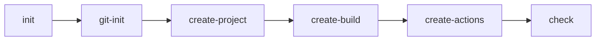

# Архітектура AI-агента build-engineer

## Проблема, яку вирішує агент

Початкове налаштування невеликого JavaScript/Node.js-проєкту часто виконується вручну: потрібно створити структуру файлів, описати npm scripts, додати тестування, кросплатформні CI-скрипти та GitHub Actions. Це створює ризик пропустити перевірку, зробити скрипт несумісним з іншою операційною системою або випадково додати службові файли до Git.

Агент `build-engineer` для GitHub Copilot у VS Code оркеструє ці кроки в установленому порядку. Він готує проєкт Hello World на JavaScript, тест `BasicAddition` на Jest, скрипти `ci.sh`/`ci.bat` і workflow GitHub Actions для Linux, Windows та macOS, а потім перевіряє результат.

## Skills

| Skill | Входи | Виходи |
|---|---|---|
| `project-scaffold` | Мова JavaScript і назва проєкту `hello` | Мінімальний Hello World у `src/hello.js`, README, каталоги `src/`, `tests/`, `docs/` і початковий `.gitignore`; перевірка вихідного файлу та команди запуску |
| `build-and-test` | Структура проєкту та вихідний код | `package.json` з npm scripts, функція `add(a, b)`, тест `BasicAddition` у `tests/hello.test.js`, `ci.sh`, `ci.bat`, devDependency `@yao-pkg/pkg`, файл `build/hello` або `build/hello.exe` |
| `github-actions` | Проєкт, локальні CI-скрипти та вимоги до платформ | `.github/workflows/ci.yml` з однією job і matrix для `ubuntu-latest`, `windows-latest`, `macos-latest`, яка запускає лише `ci.sh` або `ci.bat` і зберігає executable як artifact |

## Commands

| Command | Передумови | Результат |
|---|---|---|
| `git-init` | Відкрито корінь репозиторію | Перевірено репозиторій, створено або оновлено `.gitignore` без дублювання рядків і показано `git status` |
| `create-project` | Виконано `git-init` | Створено мінімальний JavaScript/Node.js-проєкт `hello`: `src/hello.js`, README, каталоги `src/`, `tests/`, `docs/` і початковий `.gitignore`; без тесту |
| `create-build` | Створено проєкт і його вихідний код | Додано `package.json` з npm scripts, функцію `add(a, b)`, тест `BasicAddition` у `tests/hello.test.js`, `ci.sh`, `ci.bat` і локальну збірку через `@yao-pkg/pkg` у `build/hello` або `build/hello.exe` |
| `create-actions` | Працює локальна збірка і тести | Додано workflow GitHub Actions для трьох операційних систем |
| `check` | Виконано попередні етапи | Без зміни проєкту пройдено всі перевірки структури, manifest, skills, commands, конфігурації, складання, тестів і YAML workflow; показано PASS/FAIL для кожної перевірки, пропущені перевірки не вважаються успішними |
| `init` | Доступний агент `build-engineer` | Послідовно виконано `git-init` → `create-project` → `create-build` → `create-actions` → `check` |

## Дані між етапами

Оркестратор передає між commands і skills такі дані:

- **назва проєкту:** `hello`;
- **мова:** JavaScript (Node.js);
- **шляхи файлів:** шляхи до `src/hello.js`, `README.md`, `package.json`, тесту, `ci.sh`, `ci.bat`, `.github/workflows/ci.yml` і `build/hello`;
- **код повернення та результати перевірок:** числовий код завершення команд, який визначає PASS або FAIL;
- **платформи CI:** Linux (`ubuntu-latest`), Windows (`windows-latest`) і macOS (`macos-latest`).

## Обробка помилок оркестратором

Оркестратор `init` зупиняє послідовність на першій помилці. Натомість команда `check` не змінює проєкт і проходить усі перевірки, показуючи для кожної явний звіт `PASS` або `FAIL` із назвою та причиною. Пропущена перевірка не вважається успішною. Приховані виправлення та автоматичне ігнорування помилок не допускаються.

## Відповідність файлів і ролей

| Файл або каталог | Роль |
|---|---|
| `.github/agents/build-engineer.agent.md` | Manifest custom agent із роллю, правилами та доступними інструментами |
| `.github/prompts/*.prompt.md` | Визначення commands агента: `git-init`, `create-project`, `create-build`, `create-actions`, `check`, `init` |
| `.github/skills/*/SKILL.md` | Інструкції skills: `project-scaffold`, `build-and-test`, `github-actions` |
| `.github/workflows/ci.yml` | Workflow GitHub Actions для трьох платформ, який створює агент |
| `package.json` | Опис Node.js-проєкту та npm scripts; виконує роль системи складання замість `CMakeLists.txt` з прикладу методички |
| `ci.sh`, `ci.bat` | Кросплатформні локальні CI-скрипти, які встановлюють залежності, запускають тести та створюють executable через `@yao-pkg/pkg` |
| `build/hello` або `build/hello.exe` | Результат локальної збірки, який не додається до Git |
| `.gitignore` | Виключення залежностей, результатів збірки, логів і локальних налаштувань |
| `docs/` | Документація архітектури та журнал взаємодії з AI |

Copilot використовує `.github/agents/*.agent.md` для агента, `.github/prompts/*.prompt.md` для commands і `.github/skills/*/SKILL.md` для skills.

## Схема взаємодії

